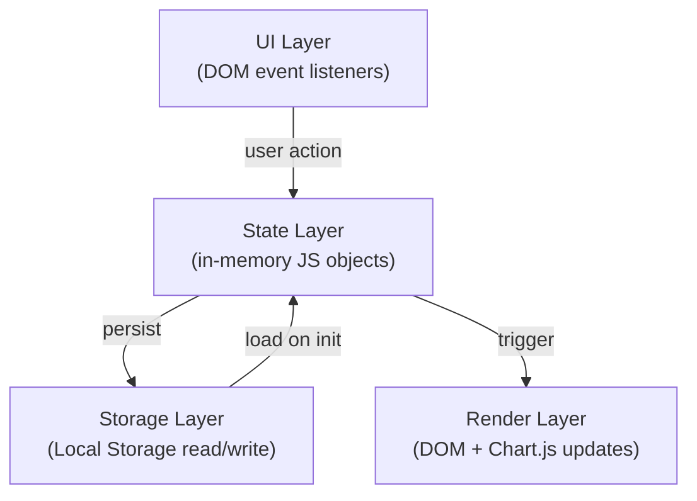
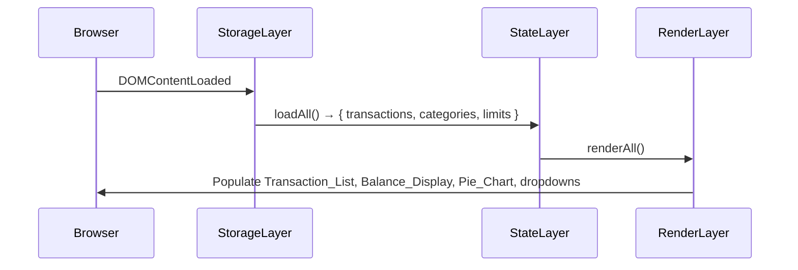

# Design Document

## Overview

The Expense & Budget Visualizer is a fully client-side, single-page web application built with vanilla HTML, CSS, and JavaScript. It runs entirely in the browser with no backend: all data is persisted in the browser's Local Storage. The application provides transaction entry, a scrollable transaction list with delete support, a live-updating total balance display, a Chart.js pie chart showing spending by category, custom category management, per-category spending limits with overspending highlights, a monthly summary view, and graceful error handling when Local Storage is unavailable.

The file structure is intentionally minimal:

```
index.html          ← single HTML entry point
css/
  style.css         ← all styles
js/
  app.js            ← all application logic
```

Chart.js v4 is loaded from the jsDelivr CDN (`https://cdn.jsdelivr.net/npm/chart.js`) and accessed through the global `Chart` object. No build tools, bundlers, or transpilers are used.

---

## Architecture

The application follows a layered, event-driven architecture within a single JavaScript file. There is no virtual DOM or reactive framework; instead, every mutation to application state is immediately persisted to Local Storage and triggers a targeted DOM re-render.

### Layers



- **UI Layer** — attaches `addEventListener` handlers to form submissions, button clicks, and selector changes. Reads raw input values, delegates validation to the State Layer.
- **State Layer** — holds the canonical application state as plain JS objects in module-level variables. All mutation functions live here. After every mutation, Storage and Render are called.
- **Storage Layer** — a thin wrapper around `localStorage.getItem` / `localStorage.setItem` with try/catch guards on every call.
- **Render Layer** — pure functions that read current state and update specific DOM nodes or the Chart.js instance. Render functions are always called with the full current state; they do not perform reads from Local Storage.

### Initialization Flow



---

## Components and Interfaces

### HTML Structure (index.html)

```
<body>
  #app
  ├── header
  │   └── #balance-display          ← Balance_Display
  ├── main
  │   ├── section#input-section
  │   │   ├── form#transaction-form  ← Input_Form
  │   │   │   ├── #item-name (text input)
  │   │   │   ├── #item-amount (number input)
  │   │   │   ├── #item-category (select)
  │   │   │   └── button[type=submit]
  │   │   └── div#input-errors
  │   ├── section#category-section
  │   │   ├── form#category-form
  │   │   │   ├── #category-name (text input)
  │   │   │   └── button[type=submit]
  │   │   └── div#category-error
  │   ├── section#limit-section
  │   │   ├── select#limit-category
  │   │   ├── #limit-amount (number input)
  │   │   ├── button#set-limit
  │   │   ├── button#remove-limit
  │   │   └── div#limit-error
  │   ├── section#chart-section
  │   │   ├── canvas#pie-chart
  │   │   └── div#chart-placeholder  ← shown when no data
  │   ├── section#monthly-section
  │   │   ├── button#open-monthly
  │   │   └── dialog#monthly-dialog (or div overlay)
  │   │       ├── select#month-select
  │   │       ├── select#year-select
  │   │       ├── div#monthly-results
  │   │       └── button#close-monthly
  │   └── section#list-section
  │       ├── div#transaction-list   ← Transaction_List
  │       └── div#list-empty-state   ← shown when no transactions
  └── div#global-error               ← Local Storage unavailable banner
```

### JavaScript Modules (app.js — logical sections)

Since only one JS file is used, the code is organized into clearly delimited logical sections with section-comment headings:

| Section | Responsibility |
|---|---|
| `// === CONSTANTS ===` | Key names, default categories, validation limits |
| `// === STATE ===` | Module-level `state` object holding all runtime data |
| `// === STORAGE ===` | `loadAll()`, `saveTransactions()`, `saveCategories()`, `saveLimits()` |
| `// === VALIDATION ===` | Pure validation functions returning `{ valid, errors }` |
| `// === TRANSACTIONS ===` | `addTransaction()`, `deleteTransaction()` |
| `// === CATEGORIES ===` | `addCategory()`, default category initialization |
| `// === LIMITS ===` | `setLimit()`, `removeLimit()` |
| `// === RENDER ===` | `renderAll()`, `renderBalance()`, `renderList()`, `renderChart()`, `renderCategoryDropdowns()`, `renderLimitControls()` |
| `// === MONTHLY ===` | `openMonthly()`, `renderMonthly()`, `closeMonthly()` |
| `// === EVENT LISTENERS ===` | All `addEventListener` calls, wired at DOMContentLoaded |
| `// === INIT ===` | Bootstrap call: `loadAll()` → `renderAll()` |

### Public Function Signatures

```js
// Storage
function loadAll()                // → void; populates state from localStorage
function saveTransactions()       // → void; writes state.transactions to localStorage
function saveCategories()         // → void; writes state.categories to localStorage
function saveLimits()             // → void; writes state.limits to localStorage

// Validation
function validateTransaction(name, amount, category) // → { valid: bool, errors: {name?, amount?, category?} }
function validateCategory(name)                       // → { valid: bool, error: string|null }
function validateLimit(value)                         // → { valid: bool, error: string|null }

// Transactions
function addTransaction(name, amount, category)  // → void
function deleteTransaction(id)                   // → void

// Categories
function addCategory(name)  // → void

// Limits
function setLimit(category, value)   // → void
function removeLimit(category)       // → void

// Render
function renderAll()                   // → void; calls all render sub-functions
function renderBalance()               // → void
function renderList()                  // → void
function renderChart()                 // → void
function renderCategoryDropdowns()     // → void
function renderLimitControls()         // → void

// Monthly
function openMonthly()                              // → void
function renderMonthly(month, year)                 // → void
function closeMonthly()                             // → void
```

---

## Data Models

All data is serialized as JSON strings stored under fixed keys in `localStorage`.

### localStorage Keys

| Key | Value Type | Description |
|---|---|---|
| `ebv_transactions` | `Transaction[]` | All expense transactions |
| `ebv_categories` | `string[]` | Custom category names only |
| `ebv_limits` | `Record<string, number>` | Map of category name → spending limit amount |

### Transaction

```js
/**
 * @typedef {Object} Transaction
 * @property {string} id         - UUID v4 (crypto.randomUUID() or fallback)
 * @property {string} name       - Item name, 1–100 characters
 * @property {number} amount     - Positive number, up to 2 decimal places, max 999999999.99
 * @property {string} category   - Category name (default or custom)
 * @property {string} timestamp  - ISO 8601 datetime string (new Date().toISOString())
 */
```

### State Object

```js
const state = {
  /** @type {Transaction[]} */
  transactions: [],

  /** @type {string[]} All category names including defaults */
  categories: ['Food', 'Transport', 'Fun'],

  /** @type {Record<string, number>} category → spending limit */
  limits: {},

  /** @type {boolean} true when localStorage is unavailable */
  storageUnavailable: false,

  /** @type {Chart|null} Chart.js instance */
  chartInstance: null,
};
```

### Computed Aggregations (derived at render time, not stored)

```js
// Total of all transactions
function computeTotal(transactions)  // → number

// Per-category totals
function computeCategoryTotals(transactions)  // → Record<string, number>

// Whether a category is over its limit
function isOverLimit(category, totals, limits)  // → boolean

// Transactions filtered to a month/year
function filterByMonth(transactions, month, year)  // → Transaction[]
```

### Amount Formatting

A single shared formatting function is used throughout all render paths:

```js
/**
 * Format a number as currency string.
 * Uses Intl.NumberFormat with 'en-US' locale and 'USD' currency style,
 * falling back to manual formatting if Intl is unavailable.
 * @param {number} amount
 * @returns {string}  e.g. "$1,234.56"
 */
function formatAmount(amount)
```

### ID Generation

```js
/**
 * Generate a unique transaction ID.
 * Uses crypto.randomUUID() when available; falls back to
 * Date.now() + Math.random() string concatenation.
 * @returns {string}
 */
function generateId()
```

---

## Correctness Properties

*A property is a characteristic or behavior that should hold true across all valid executions of a system — essentially, a formal statement about what the system should do. Properties serve as the bridge between human-readable specifications and machine-verifiable correctness guarantees.*

### Property 1: Valid transaction addition increases list length and updates balance

*For any* valid transaction (non-empty name ≤ 100 characters, amount in the range (0, 999,999,999.99], and a non-empty category from the available category list), adding it to the application state SHALL result in the transaction list length increasing by exactly one and the computed total balance increasing by exactly the transaction's amount.

**Validates: Requirements 1.3, 3.1, 3.2**

### Property 2: Invalid transaction input is rejected and list is unchanged

*For any* form submission where the item name is empty or composed entirely of whitespace characters, or the amount is zero, negative, non-numeric, or exceeds 999,999,999.99, or the category is empty, the transaction list length SHALL remain unchanged after the submission attempt.

**Validates: Requirements 1.4, 1.5**

### Property 3: Transaction deletion removes exactly the targeted entry and adjusts the balance

*For any* non-empty list of transactions and any valid transaction ID within that list, deleting the transaction by that ID SHALL produce a list containing exactly all original transactions except the deleted one, and the computed total balance SHALL decrease by exactly the deleted transaction's amount.

**Validates: Requirements 2.4, 3.3**

### Property 4: Category dropdown reflects the complete category set

*For any* set of custom categories saved in state, the category dropdown options SHALL contain exactly the three default categories (Food, Transport, Fun) plus every custom category name, with no duplicates and no omissions.

**Validates: Requirements 1.2, 5.2**

### Property 5: Pie chart data matches category totals and percentages sum to 100%

*For any* non-empty set of transactions, the pie chart dataset SHALL have exactly one entry per category with at least one transaction, with each entry's value equal to the total spending for that category, and the sum of all segment percentages (each rounded to one decimal place) SHALL equal 100%.

**Validates: Requirements 4.1, 4.2**

### Property 6: Duplicate category names are rejected (case-insensitive)

*For any* existing set of categories and any attempted new category name whose lowercase form matches the lowercase form of any existing category name, the add-category operation SHALL leave the category list unchanged.

**Validates: Requirements 5.3**

### Property 7: Spending limit overspend detection is applied correctly to all visual indicators

*For any* category with a configured spending limit, the overspending highlight (in both the Transaction_List entries and the Pie_Chart segment) SHALL be applied if and only if the sum of all transaction amounts for that category is greater than or equal to its spending limit, and SHALL be absent otherwise.

**Validates: Requirements 6.3, 6.4**

### Property 8: Spending limit validation accepts valid values and rejects invalid values

*For any* numeric value in the range [0.01, 999,999,999.99], setting it as a spending limit SHALL succeed and persist the value. *For any* value that is zero, negative, non-numeric, or exceeds 999,999,999.99, the operation SHALL leave the limits map unchanged.

**Validates: Requirements 6.1, 6.6**

### Property 9: Monthly filter includes exactly the transactions for the selected period

*For any* set of transactions with varying timestamps and any selected calendar month M and year Y, the monthly summary SHALL include exactly those transactions whose timestamp falls within month M of year Y, and the displayed total and per-category sums SHALL match the sums computed from those filtered transactions only.

**Validates: Requirements 7.2, 7.3**

### Property 10: Local Storage round-trip preserves all application data

*For any* application state containing transactions, custom categories, and spending limits, serializing that state to Local Storage and then deserializing it via `loadAll()` SHALL produce objects that are structurally and value-equivalent to the originals.

**Validates: Requirements 8.1, 8.2, 8.3, 8.4, 8.5**

### Property 11: Amount formatting produces correct currency string for all non-negative values

*For any* non-negative numeric amount, `formatAmount(amount)` SHALL return a string that contains a currency symbol prefix, a thousands separator for values ≥ 1,000, and exactly two decimal digits — and this SHALL hold consistently across all display sites (Balance_Display, Transaction_List, Monthly_Summary).

**Validates: Requirements 2.2, 3.1**

---

## Error Handling

### Local Storage Unavailability

On initialization, `loadAll()` wraps every `localStorage` access in a try/catch. If `localStorage` itself is `undefined` or any read throws (e.g., private browsing on some browsers), `state.storageUnavailable` is set to `true` and a persistent banner (`#global-error`) is shown. The app continues in session-only mode.

Every `save*()` function also wraps `localStorage.setItem` in a try/catch:
- `QuotaExceededError` — shown as a toast/alert indicating storage is full; the in-memory state is still updated.
- JSON parse errors on read — treated as corrupt data; that key is reset to its default empty value and a warning is logged to the console.

### Transaction Deletion Failure

If `deleteTransaction()` succeeds in-memory but `saveTransactions()` throws, the UI shows an error message (Requirement 2.6) and the deletion is rolled back in memory (`state.transactions` is restored from the pre-deletion snapshot).

### Chart.js Load Failure

The `<canvas>` for the pie chart is only initialized after verifying `typeof Chart !== 'undefined'`. If Chart.js fails to load from CDN, the canvas is hidden and the placeholder message is shown permanently.

### Validation Error Display

Inline errors are rendered as `<span class="field-error">` elements injected immediately after the offending input. Errors are cleared on the next successful submission or when the user modifies the field (via `input` event listener). No third-party validation library is used.

---

## Testing Strategy

This is a vanilla JS browser application with no module system or build pipeline. The testing strategy combines manual correctness verification against the properties above and browser compatibility checks.

### Property-Based Testing

Where applicable, properties are verified with **fast-check** (a JavaScript property-based testing library) loaded via CDN in a test harness page. Each property test runs a minimum of 100 iterations with randomly generated inputs.

Each property-based test is tagged with a comment in the following format:
`// Feature: expense-budget-visualizer, Property N: <property_text>`

The pure functions listed in the Data Models section (`validateTransaction`, `validateCategory`, `validateLimit`, `computeTotal`, `computeCategoryTotals`, `isOverLimit`, `filterByMonth`, `formatAmount`) are the primary targets for property tests since they have clear input/output behavior with no DOM or localStorage dependencies.

### Manual Test Checklist (per correctness property)

| Property | Test Action |
|---|---|
| P1 – Valid transaction addition | Add transactions of varying valid amounts; verify list length increases by 1 and balance increases by exact amount |
| P2 – Invalid input rejection | Submit empty name, whitespace-only name, zero/negative/non-numeric amounts, amounts > 999,999,999.99; verify list unchanged |
| P3 – Deletion round-trip | Add 3 transactions, delete the middle one; verify remaining 2 and correct balance |
| P4 – Category dropdown completeness | Add custom categories; verify dropdown always shows all 3 defaults + all custom ones |
| P5 – Pie chart percentages | Add transactions across 3+ categories; verify segment values match totals and percentages sum to 100% |
| P6 – Category uniqueness | Attempt to add "food", "FOOD", "Food"; verify only the first succeeds |
| P7 – Overspend highlight | Set a $10 limit for Food; add $9 transaction (no highlight); add $1 more ($10 exact — highlight appears on list entry and chart segment) |
| P8 – Limit validation | Enter 0, -1, "abc", 1000000000 as limits; verify rejection. Enter 0.01 and 999999999.99; verify acceptance |
| P9 – Monthly filter | Add transactions in January, February, March; select February; verify only February transactions appear with correct totals |
| P10 – Storage round-trip | Add varied data, reload the page; verify all transactions, categories, and limits are fully restored |
| P11 – Amount formatting | Verify $0.00, $1,234.56, $999,999,999.99 display correctly in Balance_Display, Transaction_List, and Monthly_Summary |

### Browser Compatibility Testing

Test the complete feature checklist in:
- Chrome (latest stable)
- Firefox (latest stable)
- Edge (latest stable)
- Safari (latest stable on macOS/iOS)

Key compatibility checkpoints:
- `crypto.randomUUID()` — available in all modern browsers; fallback `generateId()` covers older versions
- `Intl.NumberFormat` — universally supported in target browsers
- `localStorage` — universally supported; private browsing edge case handled via try/catch
- CSS custom properties — universally supported in target browsers
- `<dialog>` element for monthly summary — supported in all modern browsers; `div` overlay fallback if needed

### Edge Cases to Verify

- 50-category limit: attempt to add a 51st custom category and verify the error message
- Max amount boundary: enter exactly 999,999,999.99 (accepted) and 1,000,000,000.00 (rejected)
- Empty transaction list: verify empty-state messages in list, chart placeholder, and monthly summary
- Local Storage full: code review confirms all `setItem` calls are wrapped in try/catch; console test by filling storage manually
- Page reload with no stored data: verify app starts with correct clean default state (3 default categories, empty transaction list, $0.00 balance)
